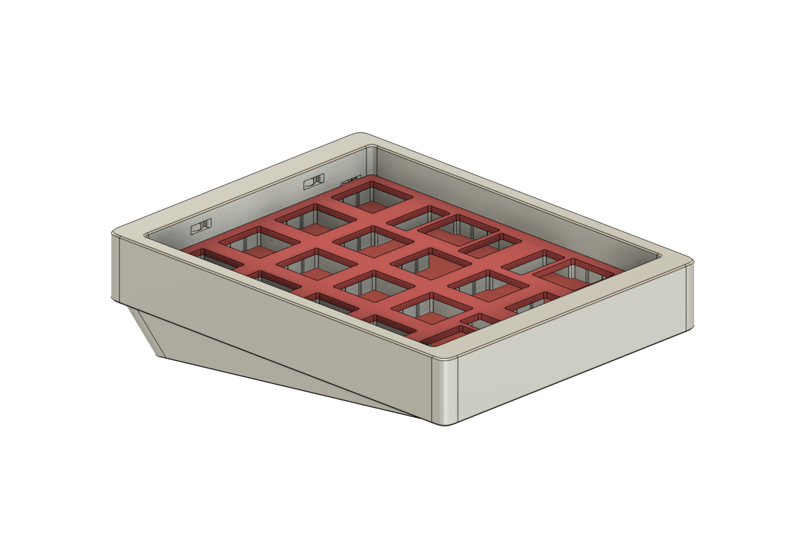
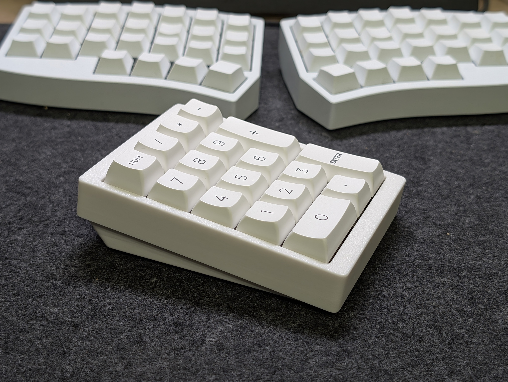
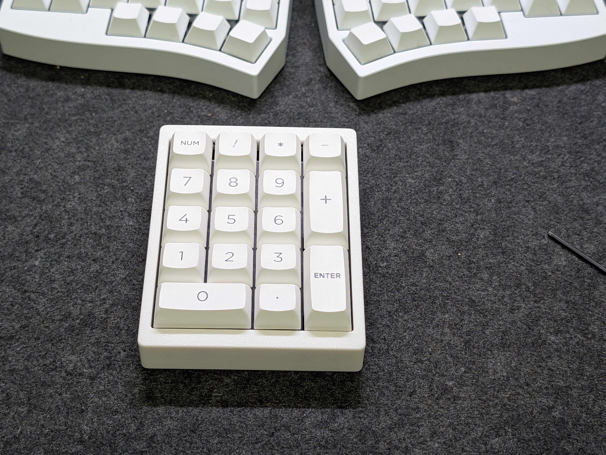

# Tenkey-Basic-Numpad

3Dプリントでの製造を想定したシンプルなテンキーケースです。

## プリントリスト

`STLs/`
- `Top.stl` - ケース上側
- `Bottom Unsupported.stl` - ケース下側
  - USBポート周りにサポートパーツが付属する`Bottom Built-In Support 0.1/0.2mm Gap.stl`もあります。印刷に利用するレイヤー厚に合ったファイルをご利用ください。
- `Plate.stl` - プレート
- `Diffuser.stl` - ミッドフォーム的な中間レイヤー
  - TPUなどで壁ループ0、上下レイヤー0などで印刷することで、フォーム層に似た効果のパーツを作製できます。

## パーツリスト
- 8 x M2.5 6角ナット
- 8 x M2.5x8mmネジ

ナットをケース上側のスロットに差し込んでください。